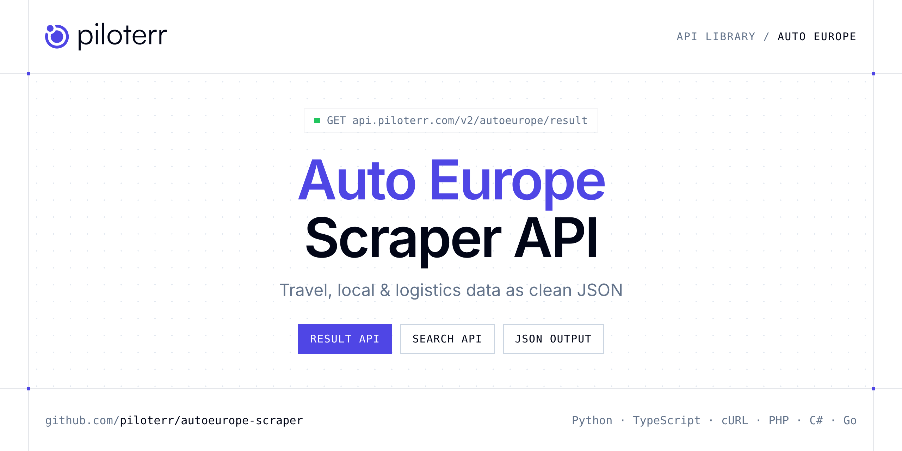

<p align="center">
  <a href="https://www.piloterr.com"></a>
</p>

# Auto Europe Scraper API

[](https://discord.gg/CFj3ph8aHU) [](https://app.piloterr.com) [](https://app.piloterr.com/openapi) [](LICENSE)

The **Piloterr Auto Europe Scraper API** lets you extract public data from Auto Europe as **clean, structured JSON** — no proxies, headless browsers or HTML parsing to maintain. Endpoints available in production:

- **Auto Europe Result API** — Read one vehicle from an Auto Europe quote.
- **Auto Europe Search API** — Quote a rental car on Auto Europe.

Use it for price tracking, review and reputation monitoring, local market research or logistics tracking.

| Endpoint | Path | Credits | What you get |
|---|---|---|---|
| [Auto Europe Result API](#auto-europe-result-api) | `/v2/autoeurope/result` | 1 | Read one vehicle from an Auto Europe quote. Pass the offer id from Search, with the same pickup and dates. You get the supplier, the SIPP code, and the package prices. |
| [Auto Europe Search API](#auto-europe-search-api) | `/v2/autoeurope/search` | 1 | Quote a rental car on Auto Europe. Pass pickup, pickup date, and dropoff date. Region chooses the country site and its currency. The whole quote comes back on one page. |

## Table of contents

- [How it works](#how-it-works)
- [Auto Europe Result API](#auto-europe-result-api)
- [Auto Europe Search API](#auto-europe-search-api)
- [Code examples in other languages](#code-examples-in-other-languages)
- [Practical use cases](#practical-use-cases)
- [Why Piloterr?](#why-piloterr)
- [FAQ](#faq)
- [Related scrapers](#related-scrapers)
- [Support](#support)

## How it works

1. **Create a free Piloterr account** and copy your API key from the [dashboard](https://app.piloterr.com).
2. **Send a `GET` (or `POST`) request** to `https://api.piloterr.com/v2/...` with the header `x-api-key: YOUR_API_KEY`.
3. **Receive structured JSON** — Piloterr handles rendering, proxies, retries and parsing.

```bash
export PILOTERR_API_KEY="your-api-key"
pip install requests        # Python
# TypeScript: Node.js 18+ (native fetch), run with `npx tsx file.ts`
```

> Every endpoint accepts both `GET` (query string) and `POST` (JSON body with the same fields).

## Auto Europe Result API

Read one vehicle from an Auto Europe quote. Pass the offer id from Search, with the same pickup and dates. You get the supplier, the SIPP code, and the package prices.

`GET | POST https://api.piloterr.com/v2/autoeurope/result` · **1 credit per request** · [Full reference](https://app.piloterr.com/openapi)

### Request parameters

| Parameter | Type | Required | Description |
|---|---|---|---|
| `offer_id` | string | ✅ | Vehicle id from search results[].id, or a package id of that vehicle. |
| `pickup` | string | ✅ | Same pickup place as the search. Example: CDG |
| `pickup_date` | string | ✅ | Same pickup date as the search, YYYY-MM-DD. Example: 2026-11-06 |
| `dropoff_date` | string | ✅ | Same return date as the search, YYYY-MM-DD, after pickup_date. Example: 2026-11-09 |
| `region` | string | — | Country site used for the search. Default fr. Example: fr. There is no page parameter. |
| `dropoff` | string | — | Return place when it differs from pickup. |
| `pickup_time` | string | — | Pickup time HH:MM. Default 10:00. |
| `dropoff_time` | string | — | Return time HH:MM. Default 10:00. |
| `driver_age` | number | — | Driver age from 18 to 99. Default 40. |
| `return_page_source` | boolean | — | When true, return the raw quote HTML instead of JSON. |

### Python example

```python
import json
import os
import requests

response = requests.get(
    "https://api.piloterr.com/v2/autoeurope/result",
    headers={"x-api-key": os.environ["PILOTERR_API_KEY"]},
    params={
        "offer_id": "3CD30DE2D9BE4CE8FC28E20D2702FCC7",
        "pickup": "CDG",
        "pickup_date": "2026-11-06",
        "dropoff_date": "2026-11-09",
    },
    timeout=60,
)
response.raise_for_status()
data = response.json()

print(json.dumps(data, indent=2, ensure_ascii=False)[:2000])
```

### TypeScript example

```typescript
type AutoEuropeResult = {
  id?: string;
  name?: string;
  sipp?: string;
  doors?: number;
  image?: string;
  price?: number;
  region?: string;
  max_age?: number;
  min_age?: number;
  category?: string;
  currency?: string;
  packages?: {
    id?: string;
    sipp?: string;
    price?: number;
    package?: string;
    location_name?: string;
    price_display?: string;
  }[];
  quote_id?: number;
  supplier?: string;
  is_luxury?: boolean;
  inclusions?: string[];
  on_airport?: boolean;
  passengers?: number;
  fuel_policy?: string;
  pickup_city?: string;
  pickup_date?: string;
  pickup_time?: string;
  rental_days?: number;
  dropoff_city?: string;
  dropoff_date?: string;
  [key: string]: unknown;
};

const params = new URLSearchParams({
  "offer_id": "3CD30DE2D9BE4CE8FC28E20D2702FCC7",
  "pickup": "CDG",
  "pickup_date": "2026-11-06",
  "dropoff_date": "2026-11-09",
});

const response = await fetch(`https://api.piloterr.com/v2/autoeurope/result?${params}`, {
  headers: { "x-api-key": process.env.PILOTERR_API_KEY! },
});
if (!response.ok) throw new Error(`Piloterr error ${response.status}: ${await response.text()}`);

const data = (await response.json()) as AutoEuropeResult;

console.log(JSON.stringify(data, null, 2).slice(0, 2000));
```

<details>
<summary><b>POST variant</b></summary>

```http
POST https://api.piloterr.com/v2/autoeurope/result
x-api-key: YOUR_API_KEY
Content-Type: application/json

{"offer_id": "3CD30DE2D9BE4CE8FC28E20D2702FCC7", "pickup": "CDG", "pickup_date": "2026-11-06", "dropoff_date": "2026-11-09"}
```
</details>

### Output example

Example response from the API reference, abridged — real values depend on the page you scrape.

```json
{
  "id": "3CD30DE2D9BE4CE8FC28E20D2702FCC7",
  "name": "Fiat 500",
  "sipp": "MBMR",
  "doors": 3,
  "image": "https://cdn.autoeurope.com/images/vehicles/jpg/medium/Fiat500_3.jpg",
  "price": 80.63,
  "region": "fr",
  "max_age": 99,
  "min_age": 26,
  "category": "mini",
  "currency": "EUR",
  "packages": [
    {
      "id": "II-73-MBMR-0008235984",
      "sipp": "MBMR",
      "price": 80.63,
      "package": "inclusive",
      "location_name": "Aéroport de Paris-Charles-de-Gaulle, Terminal 1",
      "price_display": "€80.63"
    },
    {
      "id": "II-73-MBMR-0008235985",
      "sipp": "MBMR",
      "price": 80.63,
      "package": "inclusive",
      "location_name": "Aéroport de Paris-Charles-de-Gaulle, Terminal 2D",
      "price_display": "€80.63"
    }
  ],
  "quote_id": 454710552,
  "supplier": "EUROPCAR OPAQUE",
  "is_luxury": false,
  "inclusions": [
    "Supplément environnemental",
    "Taxe routière"
  ],
  "on_airport": true,
  "passengers": 4,
  "fuel_policy": "Réservoir plein - Réservoir plein",
  "pickup_city": "PARIS",
  "pickup_date": "2026-11-06",
  "pickup_time": "10:00",
  "rental_days": 3,
  "dropoff_city": "PARIS",
  "dropoff_date": "2026-11-09"
}
```

### Response fields

| Field | Type | Description |
|---|---|---|
| `id` | string |  |
| `name` | string |  |
| `sipp` | string |  |
| `doors` | integer |  |
| `image` | string |  |
| `price` | number |  |
| `region` | string |  |
| `max_age` | integer |  |
| `min_age` | integer |  |
| `category` | string |  |
| `currency` | string |  |
| `packages[]` | object[] |  |
| `packages[].id` | string |  |
| `packages[].sipp` | string |  |
| `packages[].price` | number |  |
| `packages[].package` | string |  |
| `packages[].location_name` | string |  |
| `packages[].price_display` | string |  |
| `quote_id` | integer |  |
| `supplier` | string |  |
| `is_luxury` | boolean |  |
| `inclusions` | string[] |  |
| `on_airport` | boolean |  |
| `passengers` | integer |  |
| `fuel_policy` | string |  |

## Auto Europe Search API

Quote a rental car on Auto Europe. Pass pickup, pickup date, and dropoff date. Region chooses the country site and its currency. The whole quote comes back on one page.

`GET | POST https://api.piloterr.com/v2/autoeurope/search` · **1 credit per request** · [Full reference](https://app.piloterr.com/openapi)

### Request parameters

| Parameter | Type | Required | Description |
|---|---|---|---|
| `pickup` | string | ✅ | Pickup place or airport code. |
| `pickup_date` | string | ✅ | Pickup date, YYYY-MM-DD. |
| `dropoff_date` | string | ✅ | Return date, YYYY-MM-DD, after pickup_date. |
| `region` | string | — | Country site. Default fr. Example: fr. A code such as de or uk, or a full Auto Europe URL. There is no page parameter. |
| `dropoff` | string | — | Return place when it differs from pickup. |
| `pickup_time` | string | — | Pickup time HH:MM. Default 10:00. |
| `dropoff_time` | string | — | Return time HH:MM. Default 10:00. |
| `driver_age` | number | — | Driver age from 18 to 99. Default 40. |
| `return_page_source` | boolean | — | When true, return the raw quote HTML instead of JSON. |

### Python example

```python
import json
import os
import requests

response = requests.get(
    "https://api.piloterr.com/v2/autoeurope/search",
    headers={"x-api-key": os.environ["PILOTERR_API_KEY"]},
    params={
        "pickup": "CDG",
        "pickup_date": "2026-11-06",
        "dropoff_date": "2026-11-09",
    },
    timeout=60,
)
response.raise_for_status()
data = response.json()

print(json.dumps(data, indent=2, ensure_ascii=False)[:2000])
```

### TypeScript example

```typescript
type AutoEuropeSearch = {
  results?: {
    id?: string;
    name?: string;
    sipp?: string;
    doors?: number;
    image?: string;
    price?: number;
    region?: string;
    min_age?: number;
    category?: string;
    currency?: string;
    supplier?: string;
    is_luxury?: boolean;
    on_airport?: boolean;
    passengers?: number;
    pickup_city?: string;
    pickup_date?: string;
    pickup_time?: string;
    rental_days?: number;
    dropoff_city?: string;
    dropoff_date?: string;
    dropoff_time?: string;
    transmission?: string;
    price_display?: string;
    category_label?: string;
    pickup_country?: string;
    [key: string]: unknown;
  }[];
  pagination?: {
    next?: unknown;
    page?: number;
    per_page?: number;
    total_pages?: number;
    total_results?: number;
  };
};

const params = new URLSearchParams({
  "pickup": "CDG",
  "pickup_date": "2026-11-06",
  "dropoff_date": "2026-11-09",
});

const response = await fetch(`https://api.piloterr.com/v2/autoeurope/search?${params}`, {
  headers: { "x-api-key": process.env.PILOTERR_API_KEY! },
});
if (!response.ok) throw new Error(`Piloterr error ${response.status}: ${await response.text()}`);

const data = (await response.json()) as AutoEuropeSearch;

console.log(JSON.stringify(data, null, 2).slice(0, 2000));
```

<details>
<summary><b>POST variant</b></summary>

```http
POST https://api.piloterr.com/v2/autoeurope/search
x-api-key: YOUR_API_KEY
Content-Type: application/json

{"pickup": "CDG", "pickup_date": "2026-11-06", "dropoff_date": "2026-11-09"}
```
</details>

### Output example

Example response from the API reference, abridged — real values depend on the page you scrape.

```json
{
  "results": [
    {
      "id": "3CD30DE2D9BE4CE8FC28E20D2702FCC7",
      "name": "Fiat 500",
      "sipp": "MBMR",
      "doors": 3,
      "image": "https://cdn.autoeurope.com/images/vehicles/jpg/medium/Fiat500_3.jpg",
      "price": 80.63,
      "region": "fr",
      "min_age": 26,
      "category": "mini",
      "currency": "EUR",
      "supplier": "EUROPCAR OPAQUE",
      "is_luxury": false,
      "on_airport": true,
      "passengers": 4,
      "pickup_city": "PARIS",
      "pickup_date": "2026-11-06",
      "pickup_time": "10:00",
      "rental_days": 3,
      "dropoff_city": "PARIS",
      "dropoff_date": "2026-11-09",
      "dropoff_time": "10:00",
      "transmission": "manual",
      "price_display": "€80.63",
      "category_label": "Mini",
      "pickup_country": "FR"
    }
  ],
  "pagination": {
    "next": null,
    "page": 1,
    "per_page": 239,
    "total_pages": 1,
    "total_results": 239
  }
}
```

### Response fields

| Field | Type | Description |
|---|---|---|
| `results[]` | object[] |  |
| `results[].id` | string |  |
| `results[].name` | string |  |
| `results[].sipp` | string |  |
| `results[].doors` | integer |  |
| `results[].image` | string |  |
| `results[].price` | number |  |
| `results[].region` | string |  |
| `results[].min_age` | integer |  |
| `results[].category` | string |  |
| `results[].currency` | string |  |
| `results[].supplier` | string |  |
| `results[].is_luxury` | boolean |  |
| `results[].on_airport` | boolean |  |
| `results[].passengers` | integer |  |
| `results[].pickup_city` | string |  |
| `results[].pickup_date` | string |  |
| `results[].pickup_time` | string |  |
| `results[].rental_days` | integer |  |
| `results[].dropoff_city` | string |  |
| `results[].dropoff_date` | string |  |
| `results[].dropoff_time` | string |  |
| `results[].transmission` | string |  |
| `results[].price_display` | string |  |
| `results[].category_label` | string |  |

## Code examples in other languages

Ready-to-run examples live in the [`examples/`](examples) folder. Each one reads your key from the `PILOTERR_API_KEY` environment variable.

| Language | Result | Search |
|---|---|---|
| cURL (Bash) | [`result`](examples/curl/result.sh) | [`search`](examples/curl/search.sh) |
| PHP | [`result`](examples/php/result.php) | [`search`](examples/php/search.php) |
| C# | [`result`](examples/csharp/Result.cs) | [`search`](examples/csharp/Search.cs) |
| Go | [`result`](examples/go/result.go) | [`search`](examples/go/search.go) |
| Java | [`result`](examples/java/ResultExample.java) | [`search`](examples/java/SearchExample.java) |
| Ruby | [`result`](examples/ruby/result.rb) | [`search`](examples/ruby/search.rb) |
| Node.js | [`result`](examples/nodejs/result.mjs) | [`search`](examples/nodejs/search.mjs) |

## Practical use cases

- **Price tracking** — Monitor rates and offers over time.
- **Reputation monitoring** — Track ratings and reviews of venues and competitors.
- **Local market research** — Map businesses, venues and events by area.
- **Logistics visibility** — Follow shipments and statuses where available.
- **Travel products** — Power comparison tools and alerts with structured data.

## Why Piloterr?

- **No infrastructure** — no proxies, headless browsers or CAPTCHA solving to run yourself.
- **Structured JSON** — stable, documented fields instead of brittle HTML selectors.
- **Pay per request** — transparent credit cost per endpoint, failed requests are retried for you.
- **One API key, hundreds of sources** — Auto Europe plus many other e-commerce, search and company data endpoints in the [Piloterr library](https://www.piloterr.com/library).
- **Any language** — plain HTTPS + JSON, with examples for Python, TypeScript, cURL, PHP, C#, Go, Java, Ruby and Node.js.

## FAQ

### Is it legal to scrape Auto Europe?

Collecting publicly available data is generally allowed in many jurisdictions, but rules depend on your country, the data you collect and how you use it. Avoid personal data unless you have a lawful basis, respect the website's terms where they apply, and get legal advice for your specific use case. This is not legal advice.

### Do I need proxies or a headless browser?

No. Piloterr handles rendering, proxy rotation and retries on its side. You only send an HTTPS request with your `x-api-key` header and receive JSON.

### How much does a request cost?

Credits per call: `/v2/autoeurope/result` **1**, `/v2/autoeurope/search` **1**. See the [Piloterr website](https://www.piloterr.com) for plans.

### What data does the Auto Europe API return?

Each endpoint returns structured JSON: **Auto Europe Result** — `id`, `name`, `sipp`, `doors`, `image`, `price`; **Auto Europe Search** — `results[]`, `results[].id`, `results[].name`, `results[].sipp`, `results[].doors`, `results[].image`.

### Can I target a specific country or language?

Yes, use `region` — see the parameter tables above for accepted values.

### Can I get the raw HTML instead of JSON?

Yes. Set `return_page_source=true` and the response becomes `{"result": "..."}` with the page source.

### Which languages are supported?

Any language that can make an HTTP request. This README shows Python and TypeScript; the [`examples/`](examples) folder contains cURL, PHP, C#, Go, Java, Ruby and Node.js.

## Related scrapers

- [Eventbrite Scraper API](https://github.com/piloterr/eventbrite-scraper)
- [Expedia Scraper API](https://github.com/piloterr/expedia-scraper)
- [Maersk Scraper API](https://github.com/piloterr/maersk-scraper)
- [TheFork Scraper API](https://github.com/piloterr/thefork-scraper)
- [Yelp Scraper API](https://github.com/piloterr/yelp-scraper)
- [All Piloterr scrapers on GitHub](https://github.com/piloterr)

## Support

- 💬 Join the [Piloterr Discord](https://discord.gg/CFj3ph8aHU) to ask questions and share what you build.
- 📚 Browse the [API reference (OpenAPI)](https://app.piloterr.com/openapi) and the [Piloterr library](https://www.piloterr.com/library).
- 🔑 [Get your API key](https://app.piloterr.com).

---

<p align="center">
  <a href="https://www.piloterr.com">
    <picture>
      <source media="(prefers-color-scheme: dark)" srcset="images/logo-dark.svg">
      
    </picture>
  </a>
  <br>
  <sub>Built by <a href="https://www.piloterr.com">Piloterr</a> — web scraping APIs for e-commerce, search, real estate and more, one API key.</sub>
</p>

<sub>Auto Europe is a trademark of its respective owner. This repository is not affiliated with or endorsed by Auto Europe. Examples are released under the MIT license.</sub>
